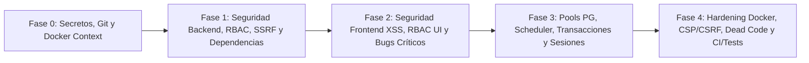

# Auditoría Integral de Seguridad, Arquitectura y Calidad + Plan de Mejora Ejecutable

**Proyecto:** Visualizador y Monitoreo de Servidores (`DiagramaServers`)  
**Fecha de auditoría:** 2026-11-09  
**Rama base auditada:** `feature/rack-adjustments-ui` (`3e26d71`)  
**Rama del plan:** `docs/auditoria-seguridad-plan-mejora`  
**Alcance:** 100 % del repositorio (`backend/**`, `frontend/public/**`, `scripts/**`, `Dockerfile`, `docker-compose.yml`, `.gitignore`, `.dockerignore`, `ecosystem.config.cjs`, `package.json`, esquemas SQL y Prisma).

---

## 1. Resumen Ejecutivo

El sistema cuenta con una base funcional valiosa (inventario de racks físicos, clusters/hosts virtuales, autenticación con sesiones y subsistema de monitoreo activo) y recientemente inició una refactorización hacia capas limpias con Prisma (`controllers` → `services` → `repositories`). Sin embargo, la coexistencia de módulos legacy con módulos nuevos, sumada a brechas importantes de endurecimiento, expone riesgos críticos de seguridad y estabilidad que deben corregirse antes de exponer o escalar el despliegue productivo.

### Matriz Global de Hallazgos

| Severidad | Cantidad | Áreas Principales Afectadas | Prioridad de Ejecución |
| :--- | :---: | :--- | :--- |
| **CRÍTICA** | **9** | Fuga de volcado SQL en Git, secretos en contexto Docker, RBAC roto en monitoreo/estáticos, SSRF/escaneo interno, credenciales por defecto, caída del proceso en `clusterRoutes`, Stored XSS en vistas y colisión crítica `app.js` vs `serverManager.js` | **Fase 0 y Fase 1–2 (Bloqueante)** |
| **ALTA** | **10** | Host Header Injection en reset de clave, Session Fixation, CORS `*` + falta de CSRF, 20 CVEs en `npm audit` (`xlsx`, `express`, `undici`, `nodemailer`, `prisma`), validación TLS SMTP desactivada, bypass IPv6 en filtro de red, fallo de carga `.env` en PM2, fuga de pools PG y bloqueos en `scheduler` | **Fase 1–3 (Prioritaria)** |
| **MEDIA** | **6** | Modo `MAINTENANCE` sobrescrito en 5 s, bug `check_results` y route shadowing en `hostsRoutes`, falta de transacciones SQL, sesiones en memoria + `cron_restart` horario, deriva SQL vs Prisma, endurecimiento `Dockerfile` / CSP / accesibilidad y ausencia de CI/tests | **Fase 3–4 (Consolidación)** |

---

## 2. Flujo de Trabajo Git para el Desarrollador Ejecutor

Este documento es la guía maestra de implementación. Para mantener trazabilidad limpia y facilitar la revisión y aprobación del Pull Request (PR):

1. **Obtener esta rama del plan:**
   ```bash
   git fetch origin
   git checkout docs/auditoria-seguridad-plan-mejora
   ```
2. **Crear la rama de implementación** (se recomienda una rama general de remediación o ramas incrementales por fase hacia esta base o hacia la rama integradora acordada):
   ```bash
   git checkout -b fix/remediacion-auditoria-seguridad
   ```
   *(Si el cambio es grande, se recomienda dividir en PRs por fase: `fix/fase1-seguridad-backend`, `fix/fase2-seguridad-frontend`, `fix/fase3-bd-monitoreo`, `fix/fase4-devops-calidad`).*
3. **Reglas de oro de no-regresión:**
   - **No romper contratos JSON externos** consumidos por el frontend actual (`/api/data`, `/api/servers`, `/api/racks`, `/api/clusters`, `/api/monitoring/*`, `/api/auth/*`, `/api/users/*`), salvo donde este plan indique explícitamente ocultar datos sensibles o exigir rol administrador.
   - **No renombrar tablas ni columnas existentes en PostgreSQL**; cualquier ajuste estructural debe hacerse mediante migraciones compatibles.
   - **Marcar cada ítem `[x]`** en la sección 4 de este documento conforme se complete y verifique.
4. **Subir cambios y abrir el Pull Request:**
   ```bash
   git push -u origin fix/remediacion-auditoria-seguridad
   ```
   Al abrir el PR en GitHub se cargará automáticamente la plantilla `.github/pull_request_template.md` para nuestra revisión y aprobación.

---

## 3. Catálogo Detallado de Hallazgos

### 3.1 Hallazgos CRÍTICOS (P0)

#### `SEC-CRIT-01` — Volcado completo de base de datos (`update_db.sql`) versionado en Git
- **Categoría:** OWASP A02 (Cryptographic/Data Exposure) / CWE-200 / CWE-312
- **Ubicación:** `update_db.sql:1-49677` y `.gitignore:25-29`
- **Diagnóstico:** `.gitignore` solo excluye `backup*.sql` y `*.dump`. El archivo `update_db.sql` está rastreado en Git y contiene un `pg_dump` completo con datos reales: tabla `users.users` con hashes bcrypt y correos (`líneas 49090-49093`), 146 registros reales de `inventory.servers` con IPs internas, hostnames, números de serie, cuentas PAM y herramientas de seguridad (`líneas 1320-1467`), destinatarios de alertas (`líneas 1486-1488`) y 47,198 ejecuciones de monitoreo.
- **Solución requerida:**
  1. Retirar el archivo del índice Git (`git rm --cached update_db.sql`).
  2. Actualizar `.gitignore` para bloquear `/*.sql`, `*.sql.gz`, `*.bak` permitiendo únicamente `!/scripts/sql/*.sql`.
  3. **Coordinado con el líder técnico:** limpiar el historial del repositorio con `git filter-repo --invert-paths --path update_db.sql` y **rotar todas las contraseñas** de usuarios del sistema y de PostgreSQL.

#### `SEC-CRIT-02` — `.dockerignore` incompleto empaqueta secretos y archivos locales dentro de la imagen Docker
- **Categoría:** OWASP A05 (Security Misconfiguration) / CWE-540
- **Ubicación:** `.dockerignore:7-12`, `Dockerfile:27`, `.gitignore:10-11`
- **Diagnóstico:** `.dockerignore` ignora `.env` y `config.json`, pero **omite** `backend/config/users.json`, `backend/uploads/`, `.env.docker`, `*.sql`, `*.dump`, `*.xlsx`, `*.csv` y `*.tar`. Como `Dockerfile:27` ejecuta `COPY backend/ ./backend/`, cualquier build local copia `backend/config/users.json` y los archivos Excel subidos dentro de las capas permanentes de la imagen del contenedor.
- **Solución requerida:**
  - Añadir a `.dockerignore`: `.env.*`, `!.env.docker.example`, `backend/config/users.json`, `backend/uploads/*`, `backend/data/*`, `*.sql`, `!scripts/sql/*.sql`, `*.dump`, `*.csv`, `*.xlsx`, `*.xls`, `*.tar`.
  - Cambiar `.gitignore:10-11` a `backend/uploads/*` con excepción `!backend/uploads/.gitkeep`.

#### `SEC-CRIT-03` — Control de acceso roto (Broken Access Control) en rutas de Monitoreo y archivos estáticos de Usuarios
- **Categoría:** OWASP A01 (Broken Access Control) / CWE-862
- **Ubicación:**
  - `backend/src/monitoring/routes/index.js:27-31`
  - `backend/src/monitoring/routes/checksRoutes.js:121, 186, 271, 298, 324`
  - `backend/src/monitoring/routes/hostsRoutes.js:277, 329, 382, 412, 447, 477, 546`
  - `backend/src/monitoring/routes/alertRecipientsRoutes.js:52`
  - `backend/server.js:169, 179`
- **Diagnóstico:**
  1. En monitoreo, únicamente `/maintenance` y `POST /sync` exigen `requireAdmin`. Todas las operaciones mutantes y destructivas de `checksRoutes.js` (`POST`, `PUT`, `DELETE`, `POST /:id/run`, `POST /bulk`) y `hostsRoutes.js` (`POST`, `PUT`, `DELETE`, `POST/DELETE /:id/maintenance`, `POST /import`, `POST /cleanup-duplicates`) son accesibles por usuarios con rol `viewer` (solo lectura).
  2. `GET /api/monitoring/alert-recipients` (`alertRecipientsRoutes.js:52`) expone la lista de nombres y correos corporativos de alertas a usuarios `viewer`.
  3. `backend/server.js:169` protege `GET /users` con `requireSuperAdmin`, pero `express.static` en la `línea 179` sirve directamente `/users.html` y `/users.js` a cualquier sesión autenticada.
- **Solución requerida:**
  - Aplicar `requireAdmin` en todos los endpoints `POST`, `PUT`, `PATCH` y `DELETE` de `checksRoutes.js` y `hostsRoutes.js`, así como en `GET /api/monitoring/alert-recipients` y `GET /api/monitoring/alert-recipients/hosts`.
  - Bloquear acceso directo a `/users.html` antes de `express.static` (o mover las plantillas HTML protegidas por rol fuera del directorio estático libre / interceptar `/users.html` con `requireSuperAdmin`).

#### `SEC-CRIT-04` — SSRF, escaneo de puertos TCP internos y fuga de cabeceras HTTP en `checkExecutorService`
- **Categoría:** OWASP A10 (SSRF) / CWE-918 / CWE-200
- **Ubicación:**
  - `backend/src/monitoring/domain/validators/checkConfigValidator.js:3-21, 35-50`
  - `backend/src/monitoring/services/checkExecutorService.js:62-112`
  - `backend/src/monitoring/scheduler/scheduler.js:149-154`
  - `backend/src/monitoring/routes/hostsRoutes.js:228-235` y `incidentsRoutes.js:189-198`
- **Diagnóstico:**
  1. `esUrlValida(url)` solo verifica que el protocolo sea `http:` o `https:`. Permite apuntar checks HTTP/TCP hacia loopback (`127.0.0.1`, `localhost`, `::1`, `0.0.0.0`), link-local/metadatos cloud (`169.254.0.0/16`), nombres internos de Docker (`postgres`) o cualquier destino arbitrario, sin validar la IP resuelta por DNS (riesgo de DNS rebinding) ni deshabilitar redirecciones abiertas.
  2. `runHTTP` guarda todas las cabeceras de la respuesta remota en `sample: { headers }`, persistidas en `check_runs.sample` y devueltas íntegras en `GET /api/monitoring/hosts/:id` e `incidents/:id` (exponiendo `Set-Cookie`, cabeceras internas, etc.).
- **Solución requerida:**
  - Implementar un validador de red centralizado (`networkTargetValidator.js`) que bloquee rangos prohibidos (`127.0.0.0/8`, `0.0.0.0/8`, `169.254.0.0/16`, `224.0.0.0/4`, `::1`, `fe80::/10`, `fc00::/7` salvo subredes corporativas explícitamente autorizadas en variable de entorno `MONITORING_ALLOWED_CIDRS`).
  - Resolver DNS con `dns.promises.lookup(hostname, { all: true })` y validar **todas** las IPs resueltas antes de conectar (usando conector seguro en `undici` con `maxRedirections: 0`).
  - No almacenar `headers` crudos en `check_runs.sample` (guardar únicamente metadatos inocuos como `{ statusCode, contentType }`).

#### `SEC-CRIT-05` — Credenciales hardcodeadas, secretos de sesión predecibles y seed automático `admin123`
- **Categoría:** OWASP A07 (Identification and Authentication Failures) / CWE-798
- **Ubicación:**
  - `backend/server.js:96` (`SESSION_SECRET || 'GrupoDanec-DiagramaServidores-2025-SecretKey'`)
  - `docker-compose.yml:14-16, 45-46, 51` (`DiagramaServers2025`, `GrupoDanec-DiagramaServidores-2025-DockerSecret`)
  - `.env.docker.example:8, 14`
  - `scripts/sql/05-seed-admin.sql:1-5` (`admin` / `admin123`, ejecutado automáticamente en Docker por `docker-compose.yml:20` y tratado como `superadmin` por `authService.js:116`)
  - Scripts con contraseñas hardcodeadas: `backend/src/debug_5am_incident.js:14-15`, `scripts/add_rack_position_fields.js:5`, `scripts/applyClusters.js:4`, `scripts/setupClusters.js:4`, `scripts/import/syncInventoryToMonitoring.js:15`, `scripts/monitoring/simulateAlert.js:25`, `scripts/monitoring/smokeAuthFlows.mjs:3`, `scripts/manage-users.js:153, 165`.
- **Solución requerida:**
  - Eliminar todos los fallbacks de contraseñas y `SESSION_SECRET` en `server.js` (usar exclusivamente `env.SESSION_SECRET` con longitud mínima >= 32 caracteres validada en `env.js`).
  - En `docker-compose.yml`, exigir variables obligatorias: `${POSTGRES_PASSWORD:?Defina POSTGRES_PASSWORD en .env}` y `${SESSION_SECRET:?Defina SESSION_SECRET en .env}`.
  - Retirar `scripts/sql/05-seed-admin.sql` del montaje automático `/docker-entrypoint-initdb.d` y reemplazarlo por un script explícito de bootstrap que genere una contraseña aleatoria segura o lea `INITIAL_ADMIN_PASSWORD` obligando cambio de clave en el primer inicio de sesión.
  - Limpiar todos los scripts en `scripts/` para que exijan `process.env.DATABASE_URL` / `POSTGRES_URL` y retirar `backend/src/debug_5am_incident.js`.

#### `SEC-CRIT-06` — Caída total del servidor (DoS) por omisión de `next` en `clusterRoutes.js` y `BigInt()` sin validación
- **Categoría:** CWE-248 (Uncaught Exception) / CWE-755
- **Ubicación:**
  - `backend/src/routes/clusterRoutes.js:7-16`
  - `backend/src/repositories/serverRepository.js:29, 55, 67, 89, 106`
  - `backend/src/repositories/rackRepository.js:28, 72, 84, 95, 111, 122`
  - `backend/src/repositories/clusterRepository.js:26, 47, 59, 70, 90-97, 112-113`
- **Diagnóstico:**
  1. En `clusterRoutes.js`, todas las rutas llaman `(req, res) => clusterController.metodo(req, res)` **sin pasar `next`**. Cuando ocurre cualquier error (ej. 404, validación `400` o conflicto `P2002`), `clusterController.js` ejecuta `next(error)` donde `next` es `undefined`, disparando `TypeError: next is not a function` dentro de una función `async` en Express 4 (promesa rechazada no manejada que termina el proceso Node.js).
  2. Todos los repositorios convierten `BigInt(id)` sin validar que `id` sea un entero positivo válido; enviar un `id` no numérico lanza `SyntaxError: Cannot convert ... to a BigInt` (HTTP 500 en vez de HTTP 400).
- **Solución requerida:**
  - Pasar `(req, res, next)` en las 8 rutas de `clusterRoutes.js` (y en `exportRoutes.js`).
  - Crear un helper `parsePositiveBigInt(value, fieldName = 'id')` que lance `ValidationError` (`400`) si el valor no cumple `/^\d+$/` o es `<= 0`, aplicándolo antes de invocar a los repositorios.

#### `SEC-CRIT-07` — Stored / Reflected DOM XSS en Monitoreo, Inventario, Clusters Virtuales y `toast.js`
- **Categoría:** OWASP A03 (Injection - Cross-Site Scripting) / CWE-79
- **Ubicación:**
  - `frontend/public/monitoring.js:870-871` (notas, resoluciones y tipo de evento en timeline de incidentes inyectados sin escapar en `body.innerHTML`).
  - `frontend/public/toast.js:139-148` (`window.showToast` inyecta `${message}` en `innerHTML` sin escapar y `${type}` sin allowlist; recibe nombres de servidores y errores de API desde `rackDragDrop.js`, `serverManager.js` y `users.js`).
  - `frontend/public/monitoring.js:442, 560-561, 576-588, 620-621, 645-647, 666-667, 685, 815-818, 1190-1191, 1913-1919` (`r.error`, `formatCheckConfig()`, `inc.summary`, `host.rack`, `host.type`, tablas de mantenimiento y `simulateAlert` sin `fmt()`).
  - `frontend/public/app.js:165-201, 4266` (`formatDiscosDisplay(s.discos)` inyectado sin `fmt()` en `serverCard`) y `frontend/public/js/modules/serverManager.js:157` (`innerHTML` directo de `server.discos`).
  - `frontend/public/app.js:2897-2899, 3003, 3005, 3091, 3143, 3149, 3465` (`v.name`, `v.description`, `group.name`, `h.name`, `cluster.source`, `host.id` sin escapar en vistas virtuales).
- **Solución requerida:**
  - En `toast.js`, construir el nodo `.toast__message` con `document.createElement` + `textContent` y validar `type` contra `['success', 'error', 'warning', 'info']`.
  - Crear/centralizar `escapeHtml(value)` y `escapeAttr(value)` en un módulo compartido y aplicarlo obligatoriamente en todos los interpoladores listados de `monitoring.js`, `app.js` y `serverManager.js` (y validar clases de rol/estado contra listas blancas en `presentacionUsuarios.js:27`).

#### `SEC-CRIT-08` — Escalada de privilegios local en tarea programada de Windows (`setup-autostart.ps1`)
- **Categoría:** CWE-250 (Execution with Unnecessary Privileges) / CWE-732
- **Ubicación:** `setup-autostart.ps1:25-31`, `start-pm2.ps1:7`, `start-pm2.bat:8`
- **Diagnóstico:** `setup-autostart.ps1` registra una tarea programada de arranque con `-RunLevel Highest` (Administrador total de Windows) y `-ExecutionPolicy Bypass` ejecutando scripts ubicados en directorios de usuario / OneDrive (`c:\Users\pasanteoptimus\OneDrive...`). Esto otorga privilegios de Administrador al proceso web Node.js y permite escalada de privilegios si cualquier proceso de usuario modifica el script.
- **Solución requerida:**
  - Cambiar `-RunLevel Highest` a `-RunLevel Limited` con cuenta de servicio sin privilegios administrativos, eliminar rutas personales hardcodeadas usando `$PSScriptRoot` / `%~dp0`, y documentar permisos NTFS de solo lectura para binarios/scripts en despliegues Windows.

#### `BUG-CRIT-09` — Colisión `app.js` vs `serverManager.js` rompe la edición de servidores y duplica envíos `POST`/`PUT` perdiendo 16 campos
- **Categoría:** Defecto Crítico Funcional e Integridad de Datos
- **Ubicación:** `frontend/public/index.html:286-287`, `virtual.html:400-401`, `app.js:735-783, 834-1038, 4049, 4357` y `js/modules/serverManager.js:50-52, 90, 260-353, 497-505`
- **Diagnóstico:**
  1. `app.js:735` define `window.serverManager = { openServerModal, openServerModalForEdit, ... }`, pero inmediatamente después `serverManager.js:499` lo sobrescribe con `new ServerManager()`, clase que **no implementa `openServerModalForEdit`**. Al hacer clic en **Editar** servidor desde rack (`app.js:4049`) o detalle (`app.js:4357`), falla con `TypeError: window.serverManager.openServerModalForEdit is not a function`.
  2. Ambos archivos registran listeners `submit` sobre `#serverForm` (`app.js:834` y `serverManager.js:51`). Como `app.js` se registra primero, el `stopImmediatePropagation()` de `serverManager.js:270` corre tarde: cada guardado dispara **dos peticiones HTTP** y el payload de `app.js` omite 16 columnas de seguridad/storage (`storage`, `ocs_inventario`, `sophos_ep`, `vicarius`, `wazuh`, `pam`, `usuario_pam`, etc.).
- **Solución requerida:**
  - Consolidar el CRUD del modal `#serverForm` en **un único módulo autoritativo** (`serverManager.js`), eliminando el listener `submit` duplicado y el objeto `window.serverManager` redundante de `app.js`, y exponiendo `openServerModalForEdit(serverOrId)` compatible con ambos flujos.

---

### 3.2 Hallazgos ALTOS (P1)

#### `SEC-HIGH-01` — Host Header Injection en recuperación/invitación de contraseña, Session Fixation y debilidades en `userController`
- **Ubicación:** `backend/src/controllers/authController.js:63, 94, 186`, `backend/src/controllers/userController.js:65, 84, 104-108, 176-195`
- **Diagnóstico:**
  1. `authController.js:186` genera `resetLink` con `${req.protocol}://${req.get('host')}` sin validar el header `Host`, permitiendo envenenar enlaces de recuperación enviados por correo. `userController.js:84` usa el mismo fallback.
  2. `authController.js:63` autentica la sesión sin llamar antes a `req.session.regenerate(...)` (vulnerable a Session Fixation), y `logout` (`línea 94`) no limpia la cookie con `res.clearCookie('connect.sid')`.
  3. `userController.js:104-108` expone `inviteLink` con token activo en la respuesta JSON si SMTP no envía, y `createUser` / `changePassword` no exigen longitud mínima de 8 caracteres (a diferencia de `login`, dejando cuentas bloqueadas si se guarda una clave de 6–7 caracteres desde `users.html` que hoy tiene `minlength="6"`).
- **Solución requerida:**
  - Construir enlaces de correo **exclusivamente** desde `env.APP_URL` validado como URL canónica al arranque.
  - Envolver el login exitoso en `req.session.regenerate((err) => { ... })` y ejecutar `res.clearCookie('connect.sid')` en `logout`.
  - Unificar política de contraseñas (`>= 10` o mínimo `>= 8` caracteres en backend y todos los formularios HTML) e invalidar sesiones activas del usuario al cambiar/restablecer su contraseña.

#### `SEC-HIGH-02` — CORS permisivo (`*`), ausencia de protección CSRF, falta de `limit` en `express.json()` y `trust proxy`
- **Ubicación:** `backend/server.js:89, 91, 95-107`, `backend/src/middleware/rateLimitMiddleware.js:11, 24-25`
- **Diagnóstico:**
  - `this.app.use(cors())` habilita `Access-Control-Allow-Origin: *` globalmente.
  - Las mutaciones basadas en cookie de sesión no verifican token CSRF ni cabecera de origen/custom header.
  - `express.json()` carece de límite explícito (por defecto permite cuerpos grandes innecesarios) y `server.js` no configura `trust proxy`, provocando que detrás de un reverse proxy todos los clientes compartan la misma IP en `rateLimitMiddleware` (bloqueo masivo) y que el `Map` `hits` crezca sin cota máxima de claves.
- **Solución requerida:**
  - Restringir `cors({ origin: env.CORS_ORIGINS, credentials: true })` (o deshabilitar CORS cross-origin si frontend y API comparten origen).
  - Implementar protección CSRF mediante token sincronizado en sesión (`GET /api/auth/csrf` -> cabecera `X-CSRF-Token` validada en todo `POST`/`PUT`/`PATCH`/`DELETE`) + verificación de cabecera `Origin`/`Referer`.
  - Configurar `express.json({ limit: '256kb' })`, `app.set('trust proxy', env.TRUST_PROXY)` parametrizable, y añadir tope máximo de entradas (ej. `10_000`) al `Map` de `rateLimitMiddleware.js`.

#### `SEC-HIGH-03` — 20 vulnerabilidades en dependencias (`npm audit`: 1 Crítica, 15 Altas, 4 Moderadas)
- **Ubicación:** `package.json` y `package-lock.json`
- **Diagnóstico:**
  - Paquetes con CVEs activos con parche disponible: `express` (`proxy-addr` Crítica, `body-parser`, `path-to-regexp`, `qs`), `undici` (bypass de validación TLS `GHSA-2m5v-pch6-74hx` y múltiples DoS), `nodemailer` (Alta), `prisma` / `@prisma/client` (Alta).
  - `xlsx@^0.18.5` (SheetJS en npm público) presenta vulnerabilidades Altas sin parche en el registro npm (`Prototype Pollution GHSA-4r6h-8v6p-xvw6` y `ReDoS GHSA-5pgg-2g8v-p4x9`).
- **Solución requerida:**
  - Actualizar `express`, `undici`, `nodemailer`, `prisma`, `@prisma/client` y `@prisma/adapter-pg` a sus versiones parcheadas ejecutando `npm audit fix` y actualizando majors requeridos de forma controlada.
  - **Reemplazar `xlsx` por `exceljs`** en `exportController.js` (y scripts de importación necesarios), eliminando definitivamente la dependencia vulnerable `xlsx`.

#### `SEC-HIGH-04` — Inyección de flags en `ping`, falso positivo `OK` en Windows y falta de límites en `checksRoutes.js`
- **Ubicación:** `backend/src/monitoring/domain/validators/checkConfigValidator.js:3-7`, `checkExecutorService.js:17-60`, `checksRoutes.js:127-128, 227-238, 330-332`
- **Diagnóstico:**
  1. `HOST_REGEX = /^[a-zA-Z0-9._-]+$/` permite valores que inician con guion (`-`), los cuales `ping` interpreta como opciones de línea de comandos.
  2. En Windows, `ping.exe -n 1 <IP-inaccesible-LAN>` retorna código de salida `0` cuando el gateway local responde `"Host de destino inaccesible"` / `"Destination host unreachable"`. Como `runICMP` no comprueba `TTL=` en `stdout`, **marca hosts apagados como `OK` (`UP`)**, y además la regex `/time[=<]/i` no reconoce `tiempo=` en Windows en español.
  3. `checksRoutes.js` permite `frequency_sec <= 0` (ejecución infinita en cada tick) o `timeout_ms` desmesurados.
- **Solución requerida:**
  - Validar `host` con `net.isIP(host) !== 0` o regex estricta RFC 1123 (inicio y fin alfanumérico, longitud `<= 253`), y anteponer `'--'` en plataformas POSIX.
  - Exigir coincidencia `/TTL=\d+/i` en Windows para considerar un ping exitoso y soportar `/(?:time|tiempo)[=<](\d+(?:\.\d+)?)\s*ms/i`.
  - Validar en `checksRoutes.js`: `frequency_sec` entero entre `15` y `86400`, `timeout_ms` entero entre `200` y `15000`, `retries` entero entre `0` y `5`.

#### `SEC-HIGH-05` — TLS sin verificación en SMTP (`rejectUnauthorized: false`), inyección HTML en correos y Formula Injection en Excel
- **Ubicación:** `notificationService.js:53, 203-241`, `scripts/test-email.mjs:32`, `passwordRecoveryService.js:52, 99`, `alertRecipientsRoutes.js:77, 281`, `exportController.js:55, 150`
- **Diagnóstico:**
  - `rejectUnauthorized: false` expone credenciales SMTP a intercepción MitM.
  - Los correos HTML de alertas y recuperación interpolan nombres de usuario/host sin escapar HTML ni limpiar saltos CR/LF en asuntos.
  - `exportController.js` vuelca cadenas directamente a celdas Excel; valores que comiencen con `=`, `+`, `-`, `@`, `\t` o `\r` pueden interpretarse como fórmulas al abrir el archivo en Excel.
- **Solución requerida:**
  - Habilitar validación TLS por defecto (`rejectUnauthorized: process.env.SMTP_TLS_REJECT_UNAUTHORIZED !== 'false'`).
  - Escapar HTML en todas las plantillas de correo y validar emails con expresión regular estricta.
  - Sanitizar celdas de texto al exportar Excel prefijando `'` cuando un string inicie con `^[=+\-@\t\r]`.

#### `SEC-HIGH-06` — Bypass IPv6 en `networkSecurityService.js`, puerto PostgreSQL `5432` expuesto en `0.0.0.0` y SQLi en scripts administrativos
- **Ubicación:** `backend/src/services/networkSecurityService.js:180`, `docker-compose.yml:22`, `scripts/monitoring/grantPrivileges.js:26-35`, `scripts/setup/setupMonitoringDb.ps1:63-76`
- **Diagnóstico:**
  - `this.localhostIPs.some(ip => clientIP.includes(ip))` busca la subcadena `'::1'`; cualquier dirección IPv6 remota terminada en `::1` (ej. `2001:db8::1` o `fe80::1`) cumple `.includes('::1')` y evade el bloqueo en redes públicas.
  - `docker-compose.yml` expone PostgreSQL (`5432`) en todas las interfaces de red del host (`0.0.0.0`).
  - `grantPrivileges.js` y `setupMonitoringDb.ps1` concatenan nombres de usuario/esquema en sentencias `GRANT` sin validar identificadores.
- **Solución requerida:**
  - Comparar igualdad exacta tras normalizar IPv4-mapped IPv6 (`clientIP.replace(/^::ffff:/, '') === '127.0.0.1' || clientIP === '::1'`).
  - En `docker-compose.yml`, enlazar PostgreSQL solo a loopback (`"127.0.0.1:${POSTGRES_PORT:-5432}:5432"`) o eliminar `ports:` en producción.
  - Validar identificadores SQL con `/^[a-zA-Z_][a-zA-Z0-9_]{0,62}$/` en scripts administrativos.

#### `ARCH-HIGH-07` — Orden de carga de `dotenv` vs `env.js` impide leer `.env` y provoca fallo de arranque en PM2
- **Ubicación:** `backend/server.js:12, 40`, `backend/src/config/env.js:1-118`, `backend/src/monitoring/config/monitoringConfig.js:4`, `ecosystem.config.cjs:24-29`
- **Diagnóstico:** `server.js:12` importa `env.js` antes de que ningún módulo ejecute `dotenv.config()`. En PM2 (`NODE_ENV=production`), `env.js` no ve las variables definidas en `.env` y termina el proceso con `process.exit(1)`. En desarrollo, asigna defaults antes de que `monitoringConfig.js` cargue `.env`, ignorando `MONITORING_ENABLED=1` o `PORT` locales.
- **Solución requerida:** Ejecutar `import 'dotenv/config';` en la primera línea de `backend/src/config/env.js` y hacer que `monitoringConfig.js` lea desde `env.js`.

#### `ARCH-HIGH-08` — `errorHandler` puenteado en `/api/monitoring` y `/api/export` + `GET /api/meta` devuelve siempre HTTP 500
- **Ubicación:** `backend/server.js:121, 196-200, 236-245`, `backend/src/controllers/metaController.js:14-29`
- **Diagnóstico:**
  - `_setupRoutes()` monta `/api/export` y `/api/monitoring` mediante promesas `import().then(...)` sin `await`, registrándolos en Express **después** de `this.app.use(errorHandler)` (`línea 245`). Además `.catch(() => {})` oculta fallos de carga.
  - `metaController.js` lee `configManager.getConfig()` sin que `configManager.load()` se invoque nunca, lanzando `TypeError` (`500`) en cada llamada a `GET /api/meta` (y si cargara, filtraría rutas internas del sistema de archivos).
- **Solución requerida:**
  - Convertir `_setupRoutes()` en `async _setupRoutes()`, hacer `await import(...)` de ambos routers **antes** de registrar `this.app.use(errorHandler)` y un manejador `404` JSON para `/api/*`.
  - Reemplazar `metaController.getMeta` para devolver metadatos reales y seguros desde Prisma/entorno (conteos básicos, versión y modo `postgresql`) sin exponer rutas de disco.

#### `ARCH-HIGH-09` — Fuga de pools PostgreSQL en `monitoringSyncService.js` y fallos estructurales del `Scheduler`
- **Ubicación:** `backend/src/services/monitoringSyncService.js:31-42, 229-259`, `backend/src/config/db.js`, `monitoringDb.js`, `prisma.js`, `scheduler.js:34-58, 105-137, 174-194`, `stateEvaluatorService.js:19-29`, `checkExecutorService.js:125-136`, `backend/server.js:281-294`
- **Diagnóstico:**
  1. `monitoringSyncService.getClient()` instancia un **`new Pool()` nuevo en cada invocación** (durante `fullSync()` crea >150 pools seguidos y dispara 150 `forceReload()`), sumado a otros 3 pools distintos en el mismo proceso.
  2. `scheduler.js` usa un único `new Client()` sin manejador `.on('error')` (si Postgres cierra la conexión, cae todo el proceso Node), ejecuta todos los checks de forma secuencial (`concurrency = 1`) sin bandera `tickRunning` (solapando ejecuciones sobre el mismo `Client`), no hace `await` de los callbacks asíncronos en `stateEvaluatorService.js`, ignora `timeout_ms` del check en TCP/HTTP (`checkExecutorService.js:133, 136`), y `setupGracefulShutdown()` en `server.js` no detiene el scheduler ni cierra los pools.
- **Solución requerida:**
  - Eliminar `monitoringSyncService.getClient()` y reutilizar un pool compartido; envolver `fullSync()` en una sola sesión/transacción con un único `forceReload()` al finalizar.
  - En `scheduler.js`: reemplazar `this.pg = new Client()` por consultas vía pool (`withMonitoringClient`), añadir guarda `if (this.tickRunning) return;`, ejecutar checks vencidos con concurrencia controlada (ej. `concurrency = 10`), convertir `evaluateAndTransition` en `async` con `await`, respetar `timeoutMs` en ICMP/TCP/HTTP, y cerrar ordenadamente HTTP server + SSE + Scheduler + Prisma/PG pools en `SIGTERM`/`SIGINT`.

#### `FE-HIGH-10` — Flujo inseguro de reset de clave, RBAC cliente fail-open, suplantación de actor, bugs en `users.js`/toasts y fugas de memoria DOM
- **Ubicación:** `frontend/public/login.html:165-193`, `app.js:49, 96-112, 1270, 2018, 2388, 2863`, `rackDragDrop.js:23`, `monitoring.js:934`, `incidentsRoutes.js:227, 277, 324, 383`, `users.js:213-217`, `nav.js:259-265`
- **Diagnóstico:**
  1. `login.html` deja `?resetToken=...` en la URL mientras carga recursos externos y solicita la nueva contraseña mediante `window.prompt()` (texto plano en pantalla).
  2. `app.js` inicializa `readOnlyUser = false` (fail-open) y ejecuta `disableReadOnlyActions()` antes de que `fetchData()` renderice botones; `rackDragDrop.js` evalúa `window.currentUser` antes de que resuelva `/api/auth/user`; `monitoring.js` muestra acciones administrativas a `viewer` y envía `user: 'admin'` hardcodeado al backend (`incidentsRoutes.js` confía en `req.body.user` en vez de `req.session.user.username`).
  3. `users.js:216` llama `passwordForm.reset()` **después** de asignar `passwordUserId.value = userId`, vaciando el ID y enviando `POST /api/users//change-password` (cambio de clave roto).
  4. `app.js:1270` define `showToast(message, duration)` sombreando `toast.js`; las 26 llamadas `showToast('...', 'error')` evalúan `setTimeout(..., NaN)` (`0ms`), haciendo desaparecer instantáneamente los errores.
  5. `wirePhysicalUX()` se vuelve a invocar en cada `renderHome()` / evento SSE acumulando cientos de listeners globales `mousemove`/`click`/`resize`; `wireClusterDetailEvents()` se llama dos veces seguidas (`app.js:2388` y `2863`) duplicando acciones; `nav.js:259` observa cambios de `style` en todo `document.body` disparándose en cada movimiento del tooltip.
- **Solución requerida:**
  - Limpiar `resetToken` de la barra de direcciones inmediatamente con `history.replaceState`, añadir `<meta name="referrer" content="no-referrer">` y reemplazar `window.prompt` por un formulario modal con `<input type="password">` + confirmación.
  - En `incidentsRoutes.js`, tomar siempre el autor desde `req.session.user.username` ignorando `req.body.user`. En frontend, inicializar RBAC en modo fail-closed (`readOnlyUser = true` por defecto) esperando la sesión antes de montar vistas/drag-and-drop.
  - Mover `passwordForm.reset()` antes de asignar `passwordUserId.value` en `users.js:213`.
  - Eliminar las implementaciones duplicadas de `showToast` en `app.js` y `monitoring.js` unificando en `toast.js` sanitizado.
  - Registrar listeners delegados globales de `wirePhysicalUX` una sola vez, quitar la llamada duplicada a `wireClusterDetailEvents()` en `app.js:2388` y limitar el `MutationObserver` de `nav.js` sin `attributeFilter: ['style']` global.

---

### 3.3 Hallazgos MEDIOS y BAJOS (P2 / P3)

| ID | Ubicación | Problema Detectado | Solución Requerida |
| :--- | :--- | :--- | :--- |
| **`MON-MED-01`** | `scheduler.js:77, 174`, `hostsRoutes.js:211, 572, 632` | 1) El modo `MAINTENANCE` de un host es sobrescrito a `UP`/`DOWN` en el siguiente tick (5 s) disparando alertas.<br>2) `GET /hosts/:id` (`línea 211`) eclipsa `GET /hosts/duplicates` (`línea 632`) lanzando error SQL `bigint`.<br>3) `POST /hosts/cleanup-duplicates` consulta la tabla inexistente `check_results` (es `check_runs`). | Respetar estado `MAINTENANCE` y ventanas activas en `maintenance_windows` durante el scheduler; mover `/duplicates` antes de `/:id` validando IDs enteros; corregir `check_results` → `check_runs`. |
| **`MON-MED-02`** | `monitoring/routes/*.js`, `scheduler.js:209-308`, `authMiddleware.js:21, 58, 135` | 1) Transiciones `DOWN ↔ DEGRADED` abren incidentes duplicados; recuperar host no cierra incidentes en `ack`; `resolve` no fija `closed_at` impidiendo purga.<br>2) Mutaciones multi-paso sin transacciones (`BEGIN`/`COMMIT`).<br>3) Todas las rutas devuelven `err.message` crudo de BD.<br>4) `authMiddleware` usa `req.path.startsWith('/api/')` (en sub-routers vale `/stats` y devuelve HTML en vez de JSON). | Evitar abrir incidente si ya existe uno `open`/`ack` para el host; cerrar `open` y `ack` al recuperar; fijar `closed_at = NOW()` al resolver; envolver mutaciones en transacciones; delegar errores 500 a `errorHandler`; cambiar `req.path` por `req.originalUrl.startsWith('/api/')`. |
| **`OPS-MED-03`** | `ecosystem.config.cjs:39, 48`, `server.js:95`, `scripts/sql/*.sql`, `scripts/**` | 1) `cron_restart: '0 * * * *'` reinicia PM2 cada hora borrando `MemoryStore` de sesiones (cierra sesión a todos los usuarios cada hora y dispara tormenta de checks).<br>2) `scripts/sql/` omite `users.password_reset_tokens` e `inventory.racks.type` presentes en `schema.prisma`.<br>3) Rutas/variables rotas en `setupMonitoringDb.ps1`, `migrate_users_to_postgres.js` y `manage-users.js` (pasa `username` donde `authService` espera `userId` sin `await`). | Eliminar `cron_restart` horario, subir `max_memory_restart` a `512M` y persistir sesiones en PostgreSQL con `connect-pg-simple`; alinear `scripts/sql/*.sql` con `schema.prisma`; reparar scripts CLI. |
| **`OPS-MED-04`** | `Dockerfile`, `docker-compose.yml`, `requestContextMiddleware.js:12, 42` | 1) `Dockerfile` single-stage incluye `python3 make g++` en producción, copia `scripts/` y deja `/app` escribible por `nodejs`.<br>2) `docker-compose.yml` sin límites de memoria/CPU/logs ni `no-new-privileges`.<br>3) `x-request-id` aceptado sin validar caracteres/longitud y `req.originalUrl` loguea query params sensibles (`resetToken`). | Convertir `Dockerfile` a multi-stage con código propiedad de `root:root` (solo `uploads` y `logs` escribibles); agregar límites y rotación de logs en Compose; validar `x-request-id` (`/^[a-zA-Z0-9._-]{1,64}$/`) y redactar tokens en logs HTTP. |
| **`FE-MED-05`** | `securityHeadersMiddleware.js:22`, `frontend/public/**`, `backend/src/**` | 1) CSP solo en `Report-Only` con `'unsafe-inline'`; `<script>` y `<style>` inline en HTML/JS y Google Fonts externo.<br>2) Llamadas `fetch` sin `AbortController`, sin manejo centralizado de `401` y waterfall secuencial N+1 en clusters (`app.js:4654`).<br>3) Mojibake UTF-8 en `serverManager.js` y `app.js`, falta `</head>` en `index.html:11`, modales sin `role="dialog"`/focus trap, y código muerto backend (`uploadController`, `sourceController`, `excelParserService`, `fileWatcherService`, `cacheService`, `queues`, `checkWorker`, `incidentService`). | Extraer scripts/estilos inline, auto-alojar fuentes y activar `Content-Security-Policy` bloqueante; crear helper `apiFetch()` con timeout + `Promise.all` en clusters; corregir UTF-8, HTML y accesibilidad WCAG AA; retirar/archivar código muerto confirmado. |
| **`QA-MED-06`** | Raíz del repositorio / `.github/workflows/` | No existen linter, pruebas automatizadas unitarias/integración ni pipeline CI para validar PRs. | Configurar ESLint + pruebas automatizadas (Node `--test` o Vitest + Supertest cubriendo Auth/RBAC, CRUD, SSRF validator y sanitización) + workflow de GitHub Actions en cada PR. |

---

## 4. Plan de Ejecución Paso a Paso (Checklist para el Desarrollador)



### Fase 0 — Higiene de Secretos, Git y Contexto de Contenedores (Inmediata)
- [x] **0.1 (`SEC-CRIT-01`)**: Ejecutar `git rm --cached update_db.sql` y actualizar `.gitignore` bloqueando `/*.sql`, `*.sql.gz`, `*.bak`, `backend/uploads/*` (con `!backend/uploads/.gitkeep` y `!/scripts/sql/*.sql`). *(Nota: coordinar con el administrador del repositorio la purga de historial Git y rotación de claves).*
- [x] **0.2 (`SEC-CRIT-02`)**: Actualizar `.dockerignore` agregando `.env.*`, `!.env.docker.example`, `backend/config/users.json`, `backend/uploads/*`, `backend/data/*`, `*.sql`, `!scripts/sql/*.sql`, `*.dump`, `*.csv`, `*.xlsx`, `*.xls`, `*.tar`.
- [x] **0.3 (`SEC-CRIT-05`)**: Eliminar todos los secretos/contraseñas por defecto en `backend/server.js:96`, `docker-compose.yml`, `.env.docker.example` y scripts bajo `scripts/`. Eliminar `backend/src/debug_5am_incident.js` y retirar `scripts/sql/05-seed-admin.sql` del arranque automático, creando en su lugar un comando seguro de inicialización de administrador.
- [x] **0.4 (`SEC-CRIT-08`)**: Corregir `setup-autostart.ps1` (`-RunLevel Limited`), `start-pm2.ps1` (`$PSScriptRoot`) y `start-pm2.bat` (`%~dp0`).

### Fase 1 — Seguridad Crítica Backend, RBAC, Anti-SSRF y Dependencias (P0/P1)
- [x] **1.1 (`ARCH-HIGH-07`)**: Añadir `import 'dotenv/config';` al inicio de `backend/src/config/env.js`, validar `SESSION_SECRET.length >= 32` y `APP_URL` válida, y consumir `env` desde `monitoringConfig.js`.
- [x] **1.2 (`SEC-CRIT-06` & `ARCH-HIGH-08`)**:
  - Pasar `(req, res, next)` en todas las rutas de `backend/src/routes/clusterRoutes.js` y `exportRoutes.js`.
  - Validar parámetros numéricos (`parsePositiveBigInt`) antes de convertir a `BigInt` en servicios/repositorios.
  - Hacer `_setupRoutes()` asíncrona en `backend/server.js`, esperando `await import(...)` de `/api/export` y `/api/monitoring` **antes** de `this.app.use(errorHandler)`.
  - Corregir `GET /api/meta` (`metaController.js`) para no depender de `configManager` nulo ni exponer rutas locales.
- [x] **1.3 (`SEC-CRIT-03` & `MON-MED-02`)**:
  - Cambiar `req.path.startsWith('/api/')` por `req.originalUrl.startsWith('/api/')` en `backend/src/middleware/authMiddleware.js`.
  - Proteger `/users.html` con `requireSuperAdmin` antes de `express.static` en `backend/server.js`.
  - Aplicar `requireAdmin` en todas las rutas mutantes (`POST`/`PUT`/`DELETE`) de `checksRoutes.js` y `hostsRoutes.js`, y en `GET /api/monitoring/alert-recipients` y `/alert-recipients/hosts`.
- [x] **1.4 (`SEC-CRIT-04` & `SEC-HIGH-04`)**:
  - Endurecer `checkConfigValidator.js` y `checkExecutorService.js`: validación estricta de IP/hostname sin guion inicial, resolución DNS previa bloqueando loopback/link-local/metadata/servicios internos salvo subredes permitidas (`MONITORING_ALLOWED_CIDRS`), sin redirecciones HTTP automáticas, y sin guardar `headers` completos en `check_runs.sample`.
  - Corregir `runICMP` en Windows verificando `TTL=` en `stdout` y soportando `tiempo=` / `time=`.
  - Validar rangos numéricos de `frequency_sec` (`15..86400`), `timeout_ms` (`200..15000`) y `retries` (`0..5`) en `checksRoutes.js`.
- [x] **1.5 (`SEC-HIGH-01` & `SEC-HIGH-02`)**:
  - Usar `req.session.regenerate()` en `authController.login` y `res.clearCookie('connect.sid')` en `logout`.
  - Construir enlaces de recuperación/invitación únicamente con `env.APP_URL` (nunca `req.get('host')`), no exponer `inviteLink` en respuestas HTTP en producción y exigir longitud mínima >= 8 caracteres en `userController.createUser` y `changePassword`.
  - Configurar `cors` restringido por `env.CORS_ORIGINS`, `express.json({ limit: '256kb' })`, `trust proxy` configurable, tope de memoria en `rateLimitMiddleware.js` y protección CSRF (`X-CSRF-Token`) en peticiones mutantes.
- [x] **1.6 (`SEC-HIGH-03`, `SEC-HIGH-05`, `SEC-HIGH-06`)**:
  - Actualizar dependencias vulnerables (`express`, `undici`, `nodemailer`, `prisma`, `@prisma/client`, `@prisma/adapter-pg`) y migrar `exportController.js` de `xlsx` a `exceljs` incluyendo sanitización contra Formula Injection (`^[=+\-@\t\r]`), dejando `npm audit --omit=dev` en **0 vulnerabilidades**.
  - Activar verificación TLS en SMTP (`notificationService.js`, `test-email.mjs`) y escapar HTML en plantillas de correo (`notificationService.js`, `passwordRecoveryService.js`, `alertRecipientsRoutes.js`).
  - Corregir comparación exacta de IP loopback en `networkSecurityService.js:180`.

### Fase 2 — Seguridad Frontend (Anti-XSS, RBAC UI) y Bugs Críticos (P0/P1)
- [x] **2.1 (`SEC-CRIT-07`)**: Sanitizar todas las interpolaciones `innerHTML` en `toast.js`, `monitoring.js`, `app.js` (`formatDiscosDisplay`, vistas y clusters virtuales), `serverManager.js` y `presentacionUsuarios.js`.
- [x] **2.2 (`BUG-CRIT-09`)**: Unificar la gestión de `#serverModal` y `#serverForm` entre `app.js` y `js/modules/serverManager.js` para reparar el botón **Editar** (`openServerModalForEdit`) y eliminar el doble envío `POST`/`PUT` preservando los 16 campos de seguridad/almacenamiento.
- [x] **2.3 (`FE-HIGH-10`)**:
  - En `users.js:213-217`, ejecutar `passwordForm.reset()` **antes** de asignar `passwordUserId.value = userId` y alinear `minlength="8"` en `users.html`.
  - Eliminar las funciones `showToast` duplicadas en `app.js` y `monitoring.js` para usar globalmente `toast.js` (corrigiendo los toasts de error que desaparecían en `0ms`).
  - En `login.html`, limpiar `?resetToken=` de inmediato con `history.replaceState`, agregar `<meta name="referrer" content="no-referrer">` y sustituir `window.prompt` por un formulario modal con campos `<input type="password">`.
  - En `incidentsRoutes.js`, registrar siempre `req.session.user.username` como autor del evento y eliminar `user: 'admin'` hardcodeado en `monitoring.js`.
  - Hacer RBAC cliente fail-closed (`readOnlyUser = true` hasta confirmar rol administrador), ocultar controles de escritura en `monitoring.html`/`monitoring.js` para `viewer`, y limpiar estado cliente + cerrar `EventSource` al hacer logout.
  - Corregir fugas de listeners en `wirePhysicalUX` (`app.js:2018`), llamada doble a `wireClusterDetailEvents` (`app.js:2388, 2863`) y `MutationObserver` costoso en `nav.js:259`.

### Fase 3 — Estabilidad de Base de Datos, Scheduler de Monitoreo y Sesiones (P1/P2)
- [x] **3.1 (`ARCH-HIGH-09`)**:
  - Eliminar `new Pool()` por llamada en `monitoringSyncService.js` reutilizando el pool compartido, agrupar `fullSync()` con una sola recarga del scheduler y unificar la gestión de pools PostgreSQL.
  - Refactorizar `scheduler.js` para usar el pool resiliente en lugar de un `pg.Client` único sin reconexión, agregar bandera `tickRunning`, concurrencia controlada, `await` en `stateEvaluatorService.evaluateAndTransition`, respeto de `timeoutMs` en ICMP/TCP/HTTP y apagado limpio (`setupGracefulShutdown`) de servidor, SSE, scheduler y pools.
- [x] **3.2 (`MON-MED-01` & `MON-MED-02`)**:
  - Respetar estado `MAINTENANCE` y `maintenance_windows` activas en el scheduler sin sobrescribir el estado cada 5 s.
  - Mover rutas estáticas (`/duplicates`, `/summary`) antes de `/:id` en `hostsRoutes.js`, validar `:id` numérico y cambiar `check_results` por `check_runs` en `cleanup-duplicates`.
  - Corregir ciclo de vida de incidentes (evitar duplicados abiertos por host, resolver `open` + `ack` en recuperación, registrar `closed_at = NOW()` en `resolve`), envolver mutaciones compuestas en transacciones SQL (`BEGIN`/`COMMIT`/`ROLLBACK`) y ocultar `err.message` crudos de BD en respuestas 500.
- [x] **3.3 (`OPS-MED-03`)**:
  - Incorporar `connect-pg-simple` para almacenar sesiones en PostgreSQL, quitar `cron_restart: '0 * * * *'` de `ecosystem.config.cjs` y ajustar `max_memory_restart: '512M'`.
  - Sincronizar `scripts/sql/*.sql` con `backend/prisma/schema.prisma` (`users.password_reset_tokens`, `inventory.racks.type`, índices únicos necesarios) y corregir rutas/parámetros en `setupMonitoringDb.ps1`, `migrate_users_to_postgres.js` y `manage-users.js`.

### Fase 4 — Hardening Docker, CSP Estricto, Limpieza de Código y CI/Tests (P2/P3)
- [ ] **4.1 (`OPS-MED-04`)**: Convertir `Dockerfile` a multi-stage (sin `python3 make g++` ni `scripts/` en imagen final, código `/app` en solo lectura para `nodejs`), restringir puerto `5432` en `docker-compose.yml` a `127.0.0.1`, añadir límites de recursos/rotación de logs + `sysctls: net.ipv4.ping_group_range`, validar `x-request-id` y redactar query params sensibles en logs.
- [ ] **4.2 (`FE-MED-05`)**: Extraer `<script>` y `<style>` inline en `login.html`, `home.html`, `index.html`, `virtual.html`, `users.html`, `toast.js` y `monitoring.js`; auto-alojar fuentes tipográficas; cambiar `Content-Security-Policy-Report-Only` a `Content-Security-Policy` activa sin `'unsafe-inline'`; crear helper `apiFetch()` con `AbortController` + `Promise.all` para hosts de clusters; corregir mojibake UTF-8 en `serverManager.js`/`app.js`, cerrar `</head>` en `index.html` y retirar código muerto confirmado.
- [ ] **4.3 (`QA-MED-06`)**: Agregar scripts `npm run lint` y `npm test` con pruebas automatizadas mínimas de regresión y seguridad (autenticación/RBAC, protección CSRF, validador anti-SSRF, CRUD de servidores/clusters y sanitización XSS) más workflow `.github/workflows/ci.yml`.

---

## 5. Protocolo de Verificación y Criterios para Aprobar el PR

Antes de marcar el PR como listo para revisión (`Ready for Review`), el desarrollador debe ejecutar y adjuntar evidencia de los siguientes controles, los cuales serán verificados durante nuestra revisión de código:

1. **Auditoría de Dependencias y Secretos:**
   ```bash
   npm audit --omit=dev
   git ls-files "*.sql" "*.env*" "*users.json"
   ```
   - Resultado esperado: **0 vulnerabilidades** en producción; ningún volcado SQL ni archivo de credenciales rastreado fuera de `scripts/sql/` y `.env.docker.example`.
2. **Pruebas Automatizadas y Sintaxis:**
   ```bash
   npm run lint
   npm test
   npx prisma validate --schema=backend/prisma/schema.prisma
   ```
3. **Verificación Funcional y de Seguridad (Smoke & Security Gate):**
   - **RBAC:** Con un usuario `viewer`, verificar que `POST/PUT/DELETE /api/monitoring/checks`, `/api/monitoring/hosts`, `/api/servers`, `/api/racks`, `/api/clusters`, `GET /api/monitoring/alert-recipients` y `GET /users.html` responden `403 Forbidden`.
   - **Anti-SSRF / Ping:** Intentar crear un check HTTP hacia `http://127.0.0.1:3000` o `http://169.254.169.254` y un check ICMP con host `-t` → ambos deben ser rechazados con `400 Bad Request`.
   - **Anti-XSS:** Crear un servidor, cluster o nota de incidente con caracteres especiales HTML (`<b>Prueba & "Comillas"</b>`) y comprobar en el navegador que se renderiza como texto literal escapado (sin interpretar etiquetas HTML) en tarjetas, modales, timeline y toasts.
   - **Integridad CRUD:** Editar un servidor existente desde vista de rack y vista de detalle verificando que abre el modal sin errores en consola, envía **una sola** petición `PUT /api/servers/:id` y conserva todos los campos físicos/virtuales. Crear un cluster con nombre duplicado en `/api/clusters` y verificar que responde `409 Conflict` sin derribar el proceso Node.js.
   - **Cambio y Reset de Contraseña:** Cambiar contraseña desde `users.html` verificando que se envía el `id` correcto (`/api/users/:id/change-password`), y probar recuperación de contraseña verificando que usa formulario oculto (`type="password"`) y enlace basado en `APP_URL`.
   - **Build Docker Limpio:** Ejecutar `docker compose build` y verificar que `/app/backend/config/users.json` y `/app/backend/uploads/*.xlsx` **no** existen dentro del contenedor recién construido.
