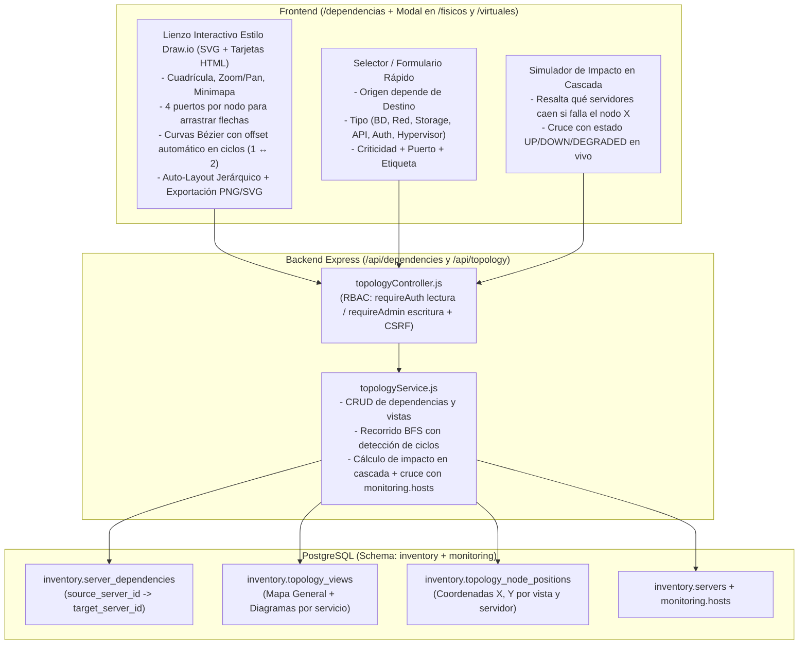
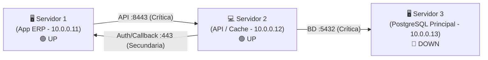

# Plan de Implementación: Mapa de Dependencias y Topología de Servidores (Estilo Draw.io)

- **Repositorio:** `https://github.com/christianamaguaproyectos/Visualizador-de-Servidores`
- **Documento en el repositorio:** [docs/PLAN-DEPENDENCIAS-Y-TOPOLOGIA-SERVIDORES.md](../docs/PLAN-DEPENDENCIAS-Y-TOPOLOGIA-SERVIDORES.md)
- **Objetivo:** Permitir relacionar servidores físicos y virtuales entre sí (incluyendo dependencias encadenadas y mutuas/ciclos como `Servidor 1 ↔ Servidor 2 → Servidor 3`), visualizarlos y editarlos en un **lienzo interactivo estilo Draw.io** (arrastrar cajas, tirar flechas con el mouse o mediante formulario, guardar múltiples vistas/diagramas, auto-ordenar y exportar a PNG/SVG) e integrar el **estado de Monitoreo en vivo** para visualizar el **impacto en cascada** cuando un servidor falla.

> [!IMPORTANT]
> **Restricción Arquitectónica Crítica (CSP Fase 4):**
> La aplicación cuenta con una `Content-Security-Policy` estricta activa en [securityHeadersMiddleware.js](../backend/src/middleware/securityHeadersMiddleware.js) (`script-src 'self'; style-src 'self'; img-src 'self' data: blob:; connect-src 'self'`).
> Por lo tanto:
> 1. **Prohibido usar CDNs externos** (`unpkg`, `jsdelivr`, etc.), etiquetas `<script>` o `<style>` inline, o atributos HTML `style="..."`.
> 2. El motor gráfico tipo Draw.io se implementará con **módulos ES nativos + SVG/HTML5** en `frontend/public/js/dominios/topologia/` y estilos en `frontend/public/css/dependencies.css` (posicionamiento dinámico vía `element.style` / CSSOM o atributos geométricos SVG `x`, `y`, `d`, `transform`, los cuales están 100% permitidos por `style-src 'self'`).

---

## 1. Arquitectura General del Nuevo Módulo

### Ejemplo del Grafo Soportado (Ciclos + Cadena + Impacto)

- **Semántica clara de la flecha (`A ──depende de──▶ B`):**
  - La flecha sale del **servidor dependiente (`source`)** y apunta hacia el **servidor proveedor (`target`)** del cual necesita para funcionar.
  - En el ejemplo: `Servidor 1` depende de `Servidor 2`; `Servidor 2` depende de `Servidor 1` y de `Servidor 3`.
  - Si `Servidor 3` pasa a `DOWN`, el motor de impacto marca a `Servidor 2` como **Afectado Directo (Nivel 1)** y a `Servidor 1` como **Afectado en Cascada (Nivel 2)**, sin entrar en bucle infinito gracias al control de nodos visitados (`Set`) en el ciclo `1 ↔ 2`.

---

## 2. División del Trabajo en 3 Fases (1 PR por Fase)

| Fase | Rama Sugerida | Alcance Principal |
| :--- | :--- | :--- |
| **Fase 1** | `feat/dependencias-fase1-backend` | Esquema SQL (`08-schema.dependencies.sql`), modelos en `schema.prisma`, servicio de grafo/impacto con soporte de ciclos y cruce con monitoreo, endpoints REST (`/api/dependencies` y `/api/topology`) y pruebas de integración del backend. |
| **Fase 2** | `feat/dependencias-fase2-canvas-drawio` | Página `/dependencias` (`dependencies.html`), enlace en `home.html` y `nav.js`, motor de lienzo interactivo estilo Draw.io (arrastrar nodos, conectar puertos con el mouse, curvas separadas para ciclos `1 ↔ 2`, formulario rápido, auto-layout, zoom/pan, guardado de posiciones). |
| **Fase 3** | `feat/dependencias-fase3-impacto-vistas-export` | Múltiples vistas/diagramas guardados, modo "Simular Caída / Análisis de Impacto en Cascada", exportación a PNG/SVG, pestaña de dependencias dentro del detalle de servidor en `/fisicos` y `/virtuales`, y suite completa de pruebas E2E/CI. |

---

## 3. Especificación Detallada por Fase

### Fase 1: Base de Datos, Modelos Prisma y API de Topología e Impacto
**Rama:** `feat/dependencias-fase1-backend`

#### 1.1 Esquema SQL (`scripts/sql/08-schema.dependencies.sql`) y Prisma (`backend/prisma/schema.prisma`)
Crear `scripts/sql/08-schema.dependencies.sql` (idempotente, dentro del esquema `inventory`):

1. **Tabla `inventory.server_dependencies`:**
   - `id BIGSERIAL PRIMARY KEY`
   - `source_server_id BIGINT NOT NULL REFERENCES inventory.servers(id) ON DELETE CASCADE` *(servidor que depende)*
   - `target_server_id BIGINT NOT NULL REFERENCES inventory.servers(id) ON DELETE CASCADE` *(servidor del cual depende)*
   - `dependency_type VARCHAR(40) NOT NULL DEFAULT 'SERVICE'` — valores permitidos validados en backend: `'DATABASE'`, `'NETWORK'`, `'STORAGE'`, `'API'`, `'AUTH'`, `'HYPERVISOR'`, `'BACKUP'`, `'DNS_INFRA'`, `'SERVICE'`.
   - `criticality VARCHAR(20) NOT NULL DEFAULT 'CRITICAL'` — valores: `'CRITICAL'`, `'HIGH'`, `'MEDIUM'`, `'LOW'`.
   - `port INT NULL CHECK (port IS NULL OR (port >= 1 AND port <= 65535))`
   - `protocol VARCHAR(20) NULL` (ej. `'TCP'`, `'HTTP'`, `'HTTPS'`, `'NFS'`, `'iSCSI'`, `'LDAP'`, `'SMB'`)
   - `label VARCHAR(120) NULL`
   - `notes TEXT NULL`
   - `created_by VARCHAR(120) NULL`
   - `created_at TIMESTAMPTZ NOT NULL DEFAULT NOW()`
   - `updated_at TIMESTAMPTZ NOT NULL DEFAULT NOW()`
   - Restricciones e índices:
     - `CONSTRAINT chk_server_dep_no_self CHECK (source_server_id <> target_server_id)`
     - `CONSTRAINT uq_server_dependency UNIQUE (source_server_id, target_server_id, dependency_type)` *(permite `1 -> 2` y `2 -> 1`, y bloquea duplicados idénticos)*
     - Índices en `(source_server_id)` y `(target_server_id)`.

2. **Tabla `inventory.topology_views`:**
   - `id BIGSERIAL PRIMARY KEY`
   - `name VARCHAR(120) NOT NULL UNIQUE`
   - `slug VARCHAR(120) NOT NULL UNIQUE`
   - `description TEXT NULL`
   - `is_default BOOLEAN NOT NULL DEFAULT FALSE`
   - `viewport_zoom DOUBLE PRECISION NOT NULL DEFAULT 1.0`
   - `viewport_x DOUBLE PRECISION NOT NULL DEFAULT 0`
   - `viewport_y DOUBLE PRECISION NOT NULL DEFAULT 0`
   - `layout_mode VARCHAR(30) NOT NULL DEFAULT 'manual'`
   - `filter_config JSONB NOT NULL DEFAULT '{}'::jsonb`
   - `created_by VARCHAR(120) NULL`
   - `created_at TIMESTAMPTZ NOT NULL DEFAULT NOW()`
   - `updated_at TIMESTAMPTZ NOT NULL DEFAULT NOW()`
   - Insertar por defecto (`ON CONFLICT (slug) DO NOTHING`) la vista `'Mapa General'` (`slug = 'general'`, `is_default = true`).

3. **Tabla `inventory.topology_node_positions`:**
   - `id BIGSERIAL PRIMARY KEY`
   - `view_id BIGINT NOT NULL REFERENCES inventory.topology_views(id) ON DELETE CASCADE`
   - `server_id BIGINT NOT NULL REFERENCES inventory.servers(id) ON DELETE CASCADE`
   - `x DOUBLE PRECISION NOT NULL`
   - `y DOUBLE PRECISION NOT NULL`
   - `pinned BOOLEAN NOT NULL DEFAULT TRUE`
   - `collapsed BOOLEAN NOT NULL DEFAULT FALSE`
   - `updated_at TIMESTAMPTZ NOT NULL DEFAULT NOW()`
   - `CONSTRAINT uq_topology_view_server UNIQUE (view_id, server_id)`

4. **Alinear `backend/prisma/schema.prisma`:**
   - Agregar los modelos `ServerDependency`, `TopologyView` y `TopologyNodePosition` con `@@schema("inventory")` y sus relaciones en `Server`, verificando que `npx prisma validate` y `npx prisma generate` pasen sin errores ni advertencias.

#### 1.2 Servicio `backend/src/services/topologyService.js`
Implementar usando el pool compartido ([db.js](../backend/src/config/db.js) / Prisma):
- **`getTopologyGraph({ viewSlugOrId, includeIsolated, simulateDownIds })`:**
  - Obtiene la vista solicitada (o `'general'` por defecto).
  - Obtiene los servidores de `inventory.servers` junto con su estado actual en `monitoring.hosts` (`LEFT JOIN` por nombre o IP limpia) y sus coordenadas `(x, y)` en `inventory.topology_node_positions` para esa vista.
  - Obtiene las aristas de `inventory.server_dependencies` y marca `isBidirectionalPair = true` cuando existe tanto `A -> B` como `B -> A`.
  - Calcula el **Impacto en Cascada (`computeCascadeImpact`)**:
    - Parte de los servidores cuyo estado en monitoreo sea `'DOWN'` o `'DEGRADED'` (más cualquier ID recibido en `simulateDownIds`).
    - Recorre las aristas en sentido inverso (`target -> source`, es decir, de proveedor caído hacia dependientes) mediante **BFS con conjunto `visited = new Set()`** para soportar ciclos (`1 ↔ 2`) en tiempo $O(V + E)$ sin colgarse jamás.
    - Adjunta a cada nodo afectado: `cascadeStatus` (`'DIRECT_IMPACT'` | `'TRANSITIVE_IMPACT'` | `'NONE'`), `impactedByServers` (lista de servidores raíz caídos que lo afectan) y `impactPath` (ruta más corta de propagación).
- **`getServerImpactAnalysis(serverId)`:**
  - Devuelve para un servidor específico:
    - `dependsOnDirect` (proveedores directos) y `dependsOnTransitive` (proveedores indirectos + profundidad).
    - `dependentsDirect` (clientes directos) y `dependentsTransitive` (todos los servidores afectados si este servidor falla).
    - `cycles` (ciclos detectados en los que participa este servidor, ej. `[1, 2, 1]`).
- **CRUD de dependencias y vistas con transacciones (`BEGIN`/`COMMIT`/`ROLLBACK`):**
  - `createDependency`, `updateDependency`, `deleteDependency`, `listDependencies`.
  - `listViews`, `createView`, `updateView`, `saveViewPositions` (guardado masivo de coordenadas `x, y` y `viewport` con `INSERT ... ON CONFLICT (view_id, server_id) DO UPDATE`), `deleteView`.

#### 1.3 Controlador y Rutas (`backend/src/controllers/topologyController.js` y `backend/src/routes/topologyRoutes.js`)
- Montar en `backend/server.js` (después de `requireAuth` y antes del manejador 404 de `/api`):
  - `GET /api/topology/graph` (`requireAuth`)
  - `GET /api/topology/views` (`requireAuth`)
  - `POST /api/topology/views` (`requireAdmin`)
  - `PUT /api/topology/views/:id` (`requireAdmin`)
  - `PUT /api/topology/views/:id/positions` (`requireAdmin`)
  - `DELETE /api/topology/views/:id` (`requireAdmin`)
  - `GET /api/dependencies` (`requireAuth`)
  - `GET /api/dependencies/server/:id/impact` (`requireAuth`)
  - `POST /api/dependencies` (`requireAdmin`)
  - `PUT /api/dependencies/:id` (`requireAdmin`)
  - `DELETE /api/dependencies/:id` (`requireAdmin`)
- Validar todos los IDs con `parsePositiveBigInt`, sanitizar cadenas de texto (`label`, `notes`, `name`) contra caracteres de control, limitar tamaños de lotes en `positions` (máx. 1000 nodos por petición) y delegar errores inesperados a `next(err)` sin exponer `err.message` crudo de PostgreSQL.

---

### Fase 2: Lienzo Interactivo Estilo Draw.io (`/dependencias`)
**Rama:** `feat/dependencias-fase2-canvas-drawio`

#### 2.1 Navegación y Página Principal (`frontend/public/dependencies.html`)
- Registrar ruta `GET /dependencias` en `backend/server.js` sirviendo `frontend/public/dependencies.html`.
- Añadir tarjeta **"Mapa de Dependencias"** en [home.html](../frontend/public/home.html) y enlace en [nav.js](../frontend/public/nav.js) con ícono de nodos conectados.
- Estructura de `dependencies.html` (100% libre de estilos/scripts inline):
  - **Barra de herramientas superior estilo Draw.io:**
    - Selector de Diagrama/Vista (`Mapa General` + vistas guardadas + botón `+ Nueva Vista`).
    - Buscador rápido de servidor en el lienzo + filtros por Tipo (`Todos`, `Físicos`, `Virtuales`), Rack/Host, Tipo de dependencia (`BD`, `Red`, `Storage`, `API`, `Auth`, etc.) y toggle `"Mostrar solo servidores con relaciones / Mostrar todos"`.
    - Botón **"+ Nueva Relación"** (abre modal de formulario rápido) y paleta lateral colapsable de servidores para **arrastrar servidores al lienzo**.
    - Controles de lienzo: `🔍+`, `🔍-`, `100%`, `⛶ Encajar`, **`✨ Auto-Ordenar`**, y botón **`💾 Guardar Posiciones`** (con indicador de auto-guardado para `admin`).

#### 2.2 Motor de Lienzo Interactivo (`frontend/public/js/dominios/topologia/lienzoDrawio.js`)
- **Renderizado Híbrido SVG + Tarjetas DOM (o SVG completo con `<foreignObject>`/grupos):**
  - Cuadrícula de fondo tipo Draw.io que escala con el zoom/paneo.
  - **Nodos (Tarjetas de Servidor):**
    - Muestran: Badge de tipo (`FÍSICO` / `VM`), Nombre, IP, Rack/Host, indicador luminoso de Monitoreo (`🟢 UP`, `🔴 DOWN`, `🟡 DEGRADED`, `🟣 MAINT`) y contador de conexiones.
    - Arrastrables con el mouse (`pointerdown` / `pointermove` / `pointerup`) con ajuste suave a la cuadrícula (*snap-to-grid* de `10px`).
    - **4 Puertos de Conexión (Norte, Sur, Este, Oeste):** visibles al pasar el mouse en sesiones `admin`.
  - **Creación de Relaciones Arrastrando con el Mouse (Draw.io Connector UX):**
    - Al arrastrar desde un puerto de `Servidor 1` hacia `Servidor 2`, se dibuja en tiempo real una línea guía curva hasta el cursor.
    - Al soltar sobre `Servidor 2`, se abre el diálogo de confirmación rápida con `Origen: Servidor 1` y `Destino: Servidor 2` ya seleccionados para elegir tipo (`DATABASE`, `NETWORK`, `STORAGE`, `API`, `AUTH`, `HYPERVISOR`, `BACKUP`), criticidad (`CRITICAL` / `HIGH` / `MEDIUM` / `LOW`), puerto y etiqueta.
  - **Creación y Edición por Formulario Rápido:**
    - Modal accesible desde el botón `"+ Nueva Relación"` con selectores buscables de `Servidor Origen (depende de)` y `Servidor Destino (proveedor)`, botón `⇄ Invertir dirección`, y opción de marcar `"Relación mutua (crear en ambos sentidos 1 ↔ 2)"`.
  - **Geometría de Flechas y Soporte Visual de Ciclos (`1 ↔ 2`):**
    - Cada dependencia se dibuja como un `<path>` Bézier cúbico con punta de flecha (`marker-end`) y pastilla de etiqueta en el punto medio (`label` / `tipo + :puerto`).
    - **Regla anti-solapamiento para ciclos (`isBidirectionalPair`):** cuando existe `1 -> 2` y `2 -> 1`, el motor calcula el vector normal unitario perpendicular al segmento `1-2` y desplaza la curva `1 -> 2` `+28px` y la curva `2 -> 1` `-28px`, de modo que ambas flechas y sus etiquetas se vean perfectamente separadas.
    - Al hacer clic en una flecha o nodo, se abre un **Panel Inspector Lateral** donde se ven sus detalles y (para `admin`) se puede editar o eliminar la relación con `confirmAction`.

#### 2.3 Algoritmo de Auto-Layout (`frontend/public/js/dominios/topologia/autoLayout.js`)
- Implementar ordenamiento automático por capas (jerárquico de izquierda a derecha o de arriba a abajo) basado en grado de dependencia:
  - Detecta ciclos mediante DFS sin bloquearse, asigna niveles topológicos (`Nivel 0`: servidores base/infraestructura/storage/BD -> `Nivel 1`: servicios intermedios -> `Nivel 2+`: aplicaciones dependientes) y distribuye los nodos con espaciado uniforme (`280px` horizontal, `150px` vertical).

---

### Fase 3: Análisis de Impacto en Cascada, Exportación, Integración en Inventario y CI
**Rama:** `feat/dependencias-fase3-impacto-vistas-export`

#### 3.1 Simulador "¿Qué pasa si cae este servidor?" e Impacto en Vivo (`simuladorImpacto.js`)
- **Impacto Real desde Monitoreo:**
  - Si un servidor está `DOWN` en monitoreo, su caja brilla en rojo, las flechas hacia los servidores que dependen de él se animan con línea de flujo roja y los servidores afectados en cascada muestran el badge `⚠️ Afectado por caída de <Nombre>`.
- **Modo Simulación Interactiva (cualquier usuario autenticado):**
  - Al activar **"⚡ Simular Caída"** sobre uno o varios nodos en el lienzo (sin alterar la base de datos ni disparar alertas reales), el lienzo resalta en tiempo real toda la cadena de impacto aguas arriba (`Nivel 1: Impacto Directo`, `Nivel 2+: Impacto en Cascada`), muestra un resumen ejecutivo (`"Si cae Servidor 2, se ven afectados 4 servidores: Servidor 1 (Crítico), ..."`), y atenúa con opacidad los nodos que no tienen relación.

#### 3.2 Exportación del Diagrama (`exportadorDiagrama.js`) y Minimapa
- Botón **"📥 Exportar"** en la barra del lienzo con 3 formatos:
  - **Exportar SVG (`.svg`):** serializa el lienzo SVG con estilos embebidos para abrirlo o imprimirlo en cualquier visor vectorial.
  - **Exportar PNG (`.png`):** renderiza el SVG en un `<canvas>` de alta densidad (`2x` retina) y descarga la imagen PNG lista para informes o presentaciones.
  - **Exportar JSON (`.json`):** descarga la definición de nodos, posiciones y relaciones de la vista actual.
- **Minimapa interactivo** en la esquina inferior derecha del lienzo mostrando el encuadre actual.

#### 3.3 Integración en el Detalle de Servidor en `/fisicos` y `/virtuales` ([app.js](../frontend/public/app.js))
- En el modal/vista de detalle de un servidor en `/fisicos` y `/virtuales`:
  - Mostrar bloque **"🔗 Dependencias e Impacto"** cargado con `apiJson('/api/dependencies/server/' + serverId + '/impact')`:
    - Lista de servidores **de los que depende** (con badge de estado y botón de eliminar para `admin`).
    - Lista de servidores **que dependen de él** (y total de afectados en cascada).
    - Botón **"+ Relacionar con otro servidor"** y botón **"🗺️ Abrir en Mapa Draw.io"** (`/dependencias?focus=<serverId>`).

#### 3.4 Pruebas Automatizadas (`tests/`) y Verificación CI
- Agregar pruebas unitarias y de integración en `tests/integration/api.test.js` (o `tests/integration/dependencies.test.js`):
  1. Crear 3 servidores (`S1`, `S2`, `S3`) y registrar el ciclo + cadena: `S1 -> S2`, `S2 -> S1` y `S2 -> S3`.
  2. Verificar que `S1 -> S1` (auto-dependencia) devuelve `400`.
  3. Verificar que `GET /api/dependencies/server/:id/impact` sobre `S3` devuelve a `S2` como dependiente directo y a `S1` como dependiente en cascada (transitivo), detectando el ciclo `[S1, S2]` sin colgarse.
  4. Verificar que `GET /api/topology/graph?simulateDownIds=<id_S3>` marca a `S2` y `S1` como afectados en cascada.
  5. Verificar guardado y lectura de posiciones `(x, y)` en `PUT /api/topology/views/:id/positions`.
  6. Verificar RBAC (`viewer` recibe `403` en `POST`/`PUT`/`DELETE` de `/api/dependencies` y `/api/topology/views`, pero `200` en `GET`).
  7. Verificar que `dependencies.html` cumple la CSP estricta (cero `<script>` inline, cero `<style>` inline y cero `style="..."`).
  8. Verificar `npm run lint` y `npm test` con 0 errores.

---

## 4. Estado de Ejecución

| Fase | Estado | Rama |
| :--- | :--- | :--- |
| **Fase 1** — Backend, esquema y API | ✅ Completada (1.1, 1.2, 1.3) | `feat/dependencias-fase1-backend` |
| **Fase 2** — Lienzo interactivo `/dependencias` | ✅ Completada (2.1, 2.2, 2.3) | `feat/dependencias-fase2-canvas-drawio` |
| **Fase 3** — Impacto, vistas, exportación e integración en inventario | ✅ Completada (3.1, 3.2, 3.3, 3.4 y 3.5 sala de racks) | `feat/dependencias-fase3-impacto-vistas-export` |

### Fase 1: entregado

- **1.1 Esquema y Prisma:** `scripts/sql/08-schema.dependencies.sql` (idempotente, se puede re-ejecutar en cualquier estado) con las tablas `inventory.server_dependencies`, `inventory.topology_views` e `inventory.topology_node_positions`, y modelos `ServerDependency`, `TopologyView` y `TopologyNodePosition` en `schema.prisma`. En bases de datos ya existentes el script se aplica a mano: ver [MIGRACION-POSTGRESQL.md](./MIGRACION-POSTGRESQL.md#aplicar-esquemas-nuevos-en-una-base-existente).
- **1.2 Servicio:** `backend/src/services/topologyService.js` (acceso a datos, transacciones, cruce con monitoreo) y `backend/src/services/topologyGraph.js` (lógica de grafo pura: impacto en cascada, pares bidireccionales, ciclos, análisis de un servidor), probada sin base de datos.
- **1.3 API:** `backend/src/controllers/topologyController.js`, `backend/src/routes/topologyRoutes.js` y validación en `backend/src/dtos/topologyDto.js`; los 11 endpoints de la sección 1.3 montados en `server.js`. Referencia completa en [API-REST.md](./API-REST.md#-dependencias-y-topología).
- **Pruebas:** unitarias del grafo y la validación (`tests/unit/topologia-grafo.test.js`) e integración de la API con PostgreSQL (`tests/integration/dependencies.test.js`), que cubren los puntos 1 a 6 de la sección 3.4. Los puntos 7 y 8 se completan con las Fases 2 y 3.

### Decisiones y diferencias respecto al plan (Fase 1)

1. **IDs como string.** Todos los IDs se devuelven como string de dígitos (`"1"`) para no perder precisión con `BIGINT`; por eso los ciclos se ven como `["1","2","1"]` y no `[1, 2, 1]`.
2. **`cycles` solo incluye los ciclos del propio servidor**, como indica 1.2. En el escenario de 3.4.3 el impacto de `S3` devuelve `cycles: []`, porque `S3` no participa en el ciclo `S1 ↔ S2`; el recorrido atraviesa ese ciclo sin bucles y el ciclo sí aparece en el análisis de `S1` y `S2`. La búsqueda de ciclos tiene un tope (`cyclesTruncated`).
3. **Transitivos sin repetir directos.** `dependsOnTransitive` y `dependentsTransitive` contienen solo profundidad ≥ 2, con `depth` y `path`. Se añade `totalAffected` (directos + transitivos) y, en los directos, las relaciones concretas (`dependencies`) con su `id`.
4. **Regla de cruce servidor ↔ host de monitoreo** igual a la de la sincronización de monitoreo: nombre exacto y, si no hay coincidencia, la primera IP del campo `ip` con forma IPv4. Dos diferencias deliberadas: en empate se toma el host de menor ID (resultado determinista) y `0.0.0.0` nunca se usa para el cruce.
5. **Raíces del impacto real:** solo hosts **habilitados** en `DOWN` o `DEGRADED`. `MAINTENANCE`, `UNKNOWN` y los hosts deshabilitados no propagan impacto.
6. **Vista por defecto:** sin `?view=` se usa la vista marcada como predeterminada (o la de slug `general`). Solo puede haber una predeterminada: marcar otra desmarca la anterior; no se puede eliminar la predeterminada (409) ni quitarle la marca sin elegir otra (400). La vista `Mapa General` solo se siembra cuando no existe ninguna vista.
7. **`includeIsolated=false` por defecto:** devuelve los servidores con relaciones, los que tienen posición guardada en la vista y los simulados.
8. **Extras sobre el plan:**
   - `POST /api/dependencies` con `bidirectional: true` crea también la inversa en la misma transacción y la informa en `inverse` (si ya existía, no es error).
   - `PUT .../positions` acepta `removeServerIds` para quitar nodos de una vista; un mismo servidor en `positions` y `removeServerIds` responde 400. `pinned` vale `true` por defecto: el auto-layout de la Fase 2 debe enviar `pinned: false` en los nodos que coloque.
   - Nodos con contadores de servidores distintos (`*ServerCount`) y de relaciones (`*RelationCount`); aristas con `isBidirectionalPair` y `carriesImpact`; resumen `impact` con caídos reales, simulados e IDs simulados ignorados.
   - Restricciones adicionales en la base de datos: tipos y criticidades válidos, formato de slug, zoom positivo y una sola vista predeterminada.
   - Límites de validación: máximo 1000 posiciones por petición, 200 IDs en `simulateDownIds`, longitudes de texto (label 120, notes 2000, description 1000) y `filterConfig` de hasta 8 KB.
   - Utilidad compartida `withTransaction` en `backend/src/config/db.js`.
   - Respuestas de error del cuerpo de la petición en toda la API: JSON inválido → 400 `VALIDATION_ERROR`; cuerpo de más de 256 KB → 413 `PAYLOAD_TOO_LARGE`.
9. **Acceso a datos con `pg`** (pool compartido) en lugar de Prisma, porque las consultas usan `LATERAL`, `unnest` y `ON CONFLICT`. Los modelos Prisma quedan alineados con las tablas.

### Fase 2: entregado

- **2.1 Página y navegación:** `GET /dependencias` sirve `frontend/public/dependencies.html` (sin scripts, estilos ni atributos `style` en línea). Enlace **Mapa de Dependencias** en la barra lateral (`nav.js`) y tarjeta en el panel de inicio; cada entrada de navegación lleva a un destino distinto y solo se marca activa la de la página actual. three.js `0.170.0` es dependencia de producción y se sirve auto-alojado en `/vendor/three` (`backend/src/routes/vendorThreeRoutes.js`, lista cerrada de tres módulos). Referencia en [API-REST.md](./API-REST.md#página-del-mapa-y-recursos-de-la-vista-3d).
- **2.2 Lienzo:** dos modos sobre los mismos datos de `GET /api/topology/graph`:
  - **Vista 3D** (por defecto, `escena3d.js`, `modelos3d.js`, `aristas3d.js`, `etiquetas3d.js`, `zonasSuelo.js`): servidores físicos como equipos de rack y VMs como cubos translúcidos, relaciones como arcos con flecha y partículas de flujo, color por estado de monitoreo e impacto, etiquetas con nivel de detalle, inspector al hacer clic.
  - **Editor 2D** (`lienzoDrawio.js`): tarjetas arrastrables con ajuste a cuadrícula de 10 px, puertos N/S/E/O para crear relaciones arrastrando, curvas Bézier con punta de flecha, separación de relaciones mutuas (`isBidirectionalPair`) y paralelas, formulario rápido con buscadores, ⇅ e inversa opcional, inspector con edición y eliminación (con confirmación) para administradores.
- **2.3 Auto-layout** (`autoLayout.js`, funciones puras): componentes fuertemente conexas (Tarjan iterativo) para que los ciclos formen un bloque, niveles por el camino más largo hasta un proveedor y orden por baricentro; disposiciones *Por capas* (280 × 150 px) y *Anillos*.
- **Pruebas:** `tests/unit/topologia-layout.test.js` (auto-layout, geometría de aristas, disposición de sala de datos, reescritura del especificador de three) y `tests/integration/dependencias-pagina.test.js` (página con la CSP estricta, `/vendor/three` con lista cerrada y 404 al resto, sin sesión no se sirve nada). Verificación en navegador real (Chromium) con la app y PostgreSQL en Docker: sin errores de consola ni violaciones de CSP.
- **Adelantado de la Fase 3** sobre la API real: simulación de caída e indicador de impacto, exportación (SVG, PNG 2D/3D, JSON), minimapa y selector/creación de vistas (se completa en la Fase 3).

### Decisiones de la Fase 2

1. **3D por defecto con disposición "Sala de datos"** (`salaDatos.js`, función pura): físicos agrupados por rack en filas rotuladas (`Fila A · <rack>`) separadas por pasillos; cada host encabeza un bloque con sus VMs en cuadrícula (el campo `rack` de una VM es su host o clúster); clústeres sin host físico en su propio bloque; zonas rotuladas en el suelo y relaciones elevadas sobre los equipos. El menú **⋯** permite usar en 3D las posiciones del Editor 2D. El 2D conserva el auto-layout por capas.
2. **Rendimiento en gráficos integrados:** render bajo demanda; etiquetas y minimapa solo se recalculan cuando cambia la cámara o los datos; animación ambiental a 30 fps como máximo y en pausa durante el giro; partículas en un solo `THREE.Points`; picking contra una caja por nodo con hover limitado a uno cada 30 ms; shaders compilados al cargar. **Modo rendimiento** automático si los fps iniciales bajan de 40 (o elegido en **⋯**): resolución 1×, sin antialias, partículas ni animación ambiental.
3. **Interfaz:** una acción por control visible; toda ventana o panel flotante (modales, inspector, indicador de impacto, leyenda, minimapa, menú **⋯**, banda de simulación, confirmaciones) se cierra con **×** además de `Esc`/Cancelar. El impacto de las caídas reales se muestra como un indicador compacto plegable que recuerda su estado.
4. **El auto-layout guarda `pinned: false`** en los nodos que coloca, como pide la API de la Fase 1.
5. **Permisos en la interfaz:** el rol `viewer` no ve controles de edición, puertos ni paleta; la API rechaza igualmente cualquier escritura (403).

### Fase 3: entregado

- **3.1 Impacto real y simulación** (`simuladorImpacto.js`): los servidores `DOWN`/`DEGRADED` de Monitoreo brillan en rojo/ámbar, las relaciones hacia sus dependientes se animan y los afectados muestran su nivel; **Simular caída** marca uno o varios servidores (clic o tecla `S`), resalta la cadena por niveles, atenúa lo no relacionado y resume *«Si cae X, se ven afectados N servidores…»* sin escribir en la base.
- **3.2 Vistas, exportación y minimapa:** selector de vistas con posiciones y encuadre propios; los administradores crean, renombran y eliminan vistas desde un único modal (la predeterminada no se elimina). **Exportar**: SVG con estilos embebidos y PNG ×2 del Editor 2D, PNG de la vista 3D y JSON con nodos, posiciones y relaciones (`exportadorDiagrama.js`). Minimapa en ambos modos. `/dependencias?focus=<id>` selecciona y centra el servidor, aunque no tenga relaciones.
- **3.3 Detalle de servidor** en `/fisicos` y `/virtuales` (`bloqueDependenciasServidor.js`, `css/dependencias-detalle.css`): bloque **Dependencias e impacto** con `GET /api/dependencies/server/:id/impact`: proveedores y dependientes con estado de monitoreo, total afectado en cascada y ciclos; para administradores, eliminar relación (con confirmación) y un formulario compacto en línea para relacionar con otro servidor; **Abrir en el mapa**.
- **Datos de demostración:** `scripts/seed-demo-topologia.js` (idempotente; `--borrar` elimina solo lo que creó). Ver [GUIA-DEMO-DOCKER.md](./GUIA-DEMO-DOCKER.md).
- **3.4 Pruebas:** `tests/integration/dependencias-fase3.test.js` (datos de demostración, ciclo de vida de vistas, bloque del detalle y páginas sin código inline) junto a `dependencies.test.js` (puntos 1 a 6) y `dependencias-pagina.test.js` (punto 7). `npm run lint` sin errores y `npm test` en verde con PostgreSQL 17. Verificación en navegador real (Chromium) con la aplicación en Docker: detalle de servidor, enfoque desde el detalle, vistas, archivos exportados válidos, simulación, cierres con **×**, sin errores de consola ni violaciones de CSP.
- **3.5 Sala de racks 3D fiel al inventario:** la disposición por defecto del 3D muestra cada rack físico del inventario (también los vacíos) como un gabinete de 42U con su nombre y ocupación (`N/42U`) en la cabecera y en el suelo; cada servidor ocupa sus unidades reales con la misma regla que la vista de rack de `/fisicos`, extraída a la función pura compartida `js/dominios/hosts/colocacionRack.js` (la usan `app.js` y `salaDatos.js`). Frontal y LED por estado de monitoreo; caídas reales con etiqueta roja visible sin hover; arcos de dependencia desde la unidad del servidor por encima de los gabinetes; VMs en la zona de virtualización. Hover con resumen (rack, U, modelo o SO); inspector con la ficha de inventario completa y ficha de rack (huecos libres, servidores por U). Tiempo real: evento `update` de `/events` para altas y bajas de servidores y racks y refresco del estado cada 30 s con la pestaña visible, sin recargar ni mover la cámara (si solo cambia el estado, se recolorean las instancias). Administradores: **Editar servidor** y **Agregar servidor en este rack** abren el formulario de `/fisicos` o `/virtuales` (`#view=server&id=N&accion=editar`, `#view=rack&name=R&accion=agregar&posicion=P`); el lector no ve esos accesos. Rendimiento: gabinetes, unidades libres, servidores y LEDs con geometría instanciada, una textura por rack para la numeración y los nombres, modo rendimiento por defecto con gráficos integrados. Datos demo con 5 racks. Pruebas: `tests/unit/colocacion-rack.test.js` (posición explícita, apilado en huecos, solapes, equipos de varias U, rack lleno), disposición de la sala en `topologia-layout.test.js` y ubicación por U de los datos demo en `dependencias-fase3.test.js`. La API no cambió: la sala usa `GET /api/data` y `GET /api/topology/graph?includeIsolated=true`.

### Decisiones de la Fase 3

1. **Formulario de relación en el detalle de servidor:** formulario compacto en línea (dirección, servidor, tipo y criticidad) en lugar de una ventana emergente; los campos avanzados (puerto, protocolo, etiqueta, notas, relación mutua) siguen en el formulario completo del mapa.
2. **Una acción por control:** **Nueva vista** y **Editar vista** comparten el modal; eliminar la vista está dentro de *Editar vista*. En el detalle, el formulario se cierra con su **×** o `Esc`.
3. **Permisos:** el `viewer` ve el bloque del detalle y **Abrir en el mapa**, pero no los botones de relacionar ni eliminar; la API rechaza igualmente cualquier escritura (403).
4. **Datos de demostración marcados:** los servidores llevan una `identity_key` con prefijo propio, los racks y hosts de monitoreo una marca; los checks de monitoreo demo quedan desactivados para que el estado no cambie solo. Si ya existe un rack con el mismo nombre, se reutiliza y no se borra.
